<div align="center">


**WELCOME TO MY LITTLE CORNER OF THE INTERNET**


[Home](https://github.com/Athina09) · [About](#cathina-type-abouttxt) · [View source](https://github.com/Athina09/Athina09)

<sub>Full-stack development · Applied AI · Cloud computing</sub>

</div>

---

### `C:\ATHINA> TYPE ABOUT.TXT`

Hi, I’m **Athina**, a Computer Science student at **Chennai Institute of Technology**, focused on **full-stack development, AI-powered applications, and cloud computing**.

I enjoy connecting thoughtful interfaces with reliable backend systems and turning ideas into working software. Through projects, internships, and open-source contributions, I’m strengthening both my engineering fundamentals and my ability to collaborate on real-world applications.

**Building:** web applications and AI-powered tools with a focus on usability and practical impact.  
**Engineering interests:** building scalable systems and designing algorithms for data-intensive applications.  
**Beyond software:** a strong interest in space and the technology that makes exploration possible.



### `C:\ATHINA> DIR PROJECTS`

```text
ACCESS DENIED.
All my projects are private for now.
```

Building behind the scenes. Public releases when they're ready.

### `C:\ATHINA> TYPE TOOLBOX.INI`

```ini
[toolbox]
languages  = JavaScript, Python, C, C++, SQL
frontend   = HTML, CSS, React, Tailwind CSS, Vite
ai_tools   = OpenCV, Hugging Face, Gradio, Ollama
cloud      = AWS, Azure, Vercel
tools      = Git, GitHub, VS Code, npm, pip

[learning]
stack      = TypeScript, Java, Node.js, Express.js
databases  = PostgreSQL, SQLite, MongoDB, Supabase
```

### `C:\ATHINA> RUN SNAKE.EXE`

<picture>
  <source media="(prefers-color-scheme: dark)" srcset="https://raw.githubusercontent.com/Athina09/Athina09/output/github-snake-dark.svg" />
  <source media="(prefers-color-scheme: light)" srcset="https://raw.githubusercontent.com/Athina09/Athina09/output/github-snake.svg" />
  
</picture>

---

<div align="center">



[← Back to profile](https://github.com/Athina09)

<sub>Building with purpose. Improving with every iteration.</sub>

</div>
