**CSE @ Chennai Institute of Technology · India**

### A little about me

I’m Athina — a computer science student who likes turning ideas into things you can actually use. My interests live somewhere between thoughtful interfaces, AI experiments, and the problem-solving behind them.

- **Building:** web projects and experiments that help me learn by doing.
- **Practising:** data structures, algorithms, and writing clearer code.
- **Exploring:** AI, cloud computing, and how the pieces of an application fit together.
- **My approach:** get curious → build something → break it → understand it better.

### My toolkit

Languages and tools I work with and continue to learn.

### From my repositories

| Project | Explore |
| :--- | :--- |
| **MacFolio** | [Open repository ↗](https://github.com/Athina09/MacFolio) |
| **AEGIS-OS** | [Open repository ↗](https://github.com/Athina09/AEGIS-OS) |
| **AI Image Generator** | [Open repository ↗](https://github.com/Athina09/AI-Image-Generator) |
| **FundChain** | [Open repository ↗](https://github.com/Athina09/FundChain) |

### The commit trail

### One contribution at a time

<picture>
  <source media="(prefers-color-scheme: dark)" srcset="https://raw.githubusercontent.com/Athina09/Athina09/output/github-snake-dark.svg" />
  <source media="(prefers-color-scheme: light)" srcset="https://raw.githubusercontent.com/Athina09/Athina09/output/github-snake.svg" />
  
</picture>

 

**Always learning. Always building.**

Thanks for stopping by — take a look around my repositories.

